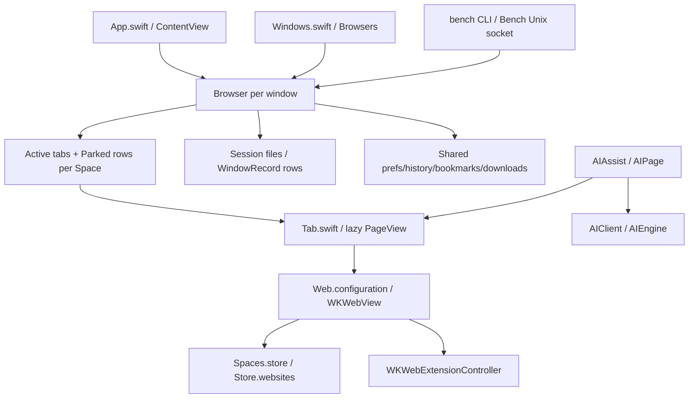

# Locus repository map

Inspected 2026-09-30. Origin: https://github.com/cryptk1ddo/locus.git.
Baseline commit: `cddb9cdd19e64321c95d5e733217799908ad3b52`.
This is a source audit of the fork, not a verified diff against today's
`driceroland/Search`. The fork still names its executable/package Search.
This map records the initial audit before browser changes. The subsequent first
implementation slice is documented in [WALL_MVP.md](WALL_MVP.md).

## Architecture as found

- `Package.swift`: SwiftPM executable, macOS 14 minimum, Swift tools 6,
  Swift language mode 5; no declared external package dependencies.
- `App.swift`: app menus, ContentView, native window/chrome coordination.
  `ContentView.stage` hosts Page or SplitStage; AI appears as an invoked overlay.
- `Browser.swift`: per-window observable coordinator; tab adoption, selection,
  navigation delegates, session conversion, Spaces, imports and UI state.
  It is already large: extend through focused files rather than expanding it.
- `Windows.swift`: one Browser per window. Shared data lives in `Shared`.
  The oldest window writes `session*.json`; other windows persist rows in
  `windows.json`. Primary-window promotion transfers persistence ownership.
- `Tab.swift`: one lazily built PageView per tab. Accessing `tab.web` creates
  it; `tab.built` observes without creation. Switching preserves the view.
  Sleeping/discarding releases WebKit and relays; interaction state and
  snapshots enable restoration during the run. Disk sessions store URLs,
  titles and browser structure, not live WKWebViews or interaction state.
- `Spaces.swift`: stable UUIDs, shared Space definitions and optional isolated
  WebKit stores. The first Space retains the original session/store.
  Other Spaces can share sign-ins or use `WKWebsiteDataStore(forIdentifier:)`.
  Active rows are parked in memory; inactive restored tabs remain lazy.
  **History, bookmarks, settings, extensions and Keychain passwords are shared.**
- `SpaceSwipe.swift`: native event monitor over tab chrome only; direction
  arbitration, inertia/rest timing and new-Space affordance. Its introductory
  animation comments concern tab rows, not a general spatial workspace.
- `Design.swift`: adaptive neutral Palette, shared Metrics and reduced-motion
  aware Motion. Logomark embeds upstream SVG path data separately from those
  design primitives.

## KEEP unchanged

| Area | Files | Preservation contract |
|---|---|---|
| WebKit lifecycle | `Tab.swift`, `Stage.swift`, `PaneStage.swift`, `SplitView.swift`, `Split.swift`, `Sleep.swift` | Keep lazy view construction, one native view owner, sleep/crash recovery, split focus and floating behavior. Wall thumbnails must never instantiate views. |
| Web configuration | `Web.configuration` and `Tab.build` in `Tab.swift` | Keep shared process pool, correct Space/private store, extension attachment before birth, UA, autoplay and notification policy. |
| Gestures/chrome | `SpaceSwipe.swift`, `Swipe.swift`, `Fold.swift`, `Side.swift`, `TabBar.swift`, `Lights.swift`, `Plate.swift` | Preserve gesture boundaries and minimalist layout in the first slice. Wall pan must not be intercepted as a Space swipe. |
| Design primitives | Palette, Metrics, Motion in `Design.swift` | Reuse existing neutrals, spacing, appearance and accessibility behavior. |
| Credentials | `Vault.swift`, `Passwords.swift`, `Forms.swift`, `Passkeys.swift`, `Accounts.swift` | Keep Keychain and authentication boundaries. Never place secrets in object metadata or content. Identity migration is a separate release task. |
| Persistence machinery | `Store.swift` / Disk, existing Session decoding, `Windows.swift`, `Pins.swift` | Preserve isolated test worlds, serial atomic writes, quarantine, quit flushing, pin synchronization and window ownership. |
| Extensions | `Extensions.swift`, `Crx.swift`, `Extension*.swift`, `ExtensionsUI.swift` | Keep compatibility, permissions and lifecycle; Wall is native browser UI, not an extension page/tab. |
| Browser utilities | bookmarks, imports, downloads, reader, find, notifications, shield, URL parsing | Preserve behavior and regression coverage. These are not replacement targets for the object abstraction. |
| AI infrastructure | `AI.swift`, `AIClient.swift`, `AIPage.swift`, `AIEngine.swift`, `AISignIn.swift` | Preserve opt-in providers, credential isolation, extraction rules, transmission notice, restricted local engine and sign-in flow. |
| Automation transport | `Bench.swift`, root `bench` | Keep current CLI/protocol compatibility, user activation, socket ownership/peer checks and test-only controls. |
| Attribution/tests | `LICENSE`, `CONTRIBUTING.md`, `SECURITY.md`, `Tests/` | Retain upstream attribution and valuable regression history. |

KEEP means retain the responsibility and behavior; a small additive hook in one
of these files may still be required by a later documented slice.

## MODIFY

| Files | Smallest intended addition | Boundary |
|---|---|---|
| `Spaces.swift` | Coordinate Wall access and object cleanup by existing Space UUID; expose Open Wall in Space menu. | Keep cookies/sign-ins and parked rows as they are. No Wall data in `Space` required initially. |
| `Browser.swift` via new extension files | Per-window Wall presentation, object actions, tab/object binding. | Browser owns Tab; object storage owns durable content. |
| `App.swift`, `Tab.swift`, `TabBar.swift`, `Side.swift` | Select native Wall content in the existing page stage; a Wall button beside Bookmarks opens its tab. | One Wall per window/Space; preserve page view ownership and normal tab closing/restoration. See [WALL_TABS.md](WALL_TABS.md). |
| `Tab.swift` | Capture lifecycle hook later; access `built` and committed page identity. | No general Object superclass, no WKWebView on canvas nodes. |
| `Tab.swift`, `Browser.relook`, `ExtensionsUI.swift`, `Design.swift` | Night Colors isolated script/weak relay lifecycle, native appearance refresh, invoked settings controls and exact #1C1C1C dark ground. | Keep Web.configuration, third-party extensions, sessions and media ownership unchanged. See [NIGHT_COLORS.md](NIGHT_COLORS.md). |
| `Session.swift` + Browser session conversion | Later optional `objectID` on Entry and tolerant round trip. | Preserve live `Tab.id`, active indices, splits, pins and old sessions. First Wall slice can open object URLs without session changes. |
| `History.swift` + navigation commit hook | Later Space-tagged visit/context stream. | Current visits are globally aggregated, not already Space-local. Do not infer historic Space membership. |
| `AddressCommands.swift`, `History.swift` Suggestion, `Browser.take/submit`, `Omnibox.swift`, `Address.swift`, `SiteSearch.swift`, `Engine.swift` | Start with explicit Open Wall/Capture commands; later typed intent/results for objects, AI and tasks. | Source has URL/search/open-tab/history/command paths already; Omnibox's introductory comment understates current behavior. Ambiguous words keep existing navigation/search behavior. |
| `AIAssist.swift` | Explicit Save to Wall action for a completed answer later. | Conversations currently disappear when closed. Saving is intentional, attributed and scoped; no permanent AI sidebar or automatic agent execution. |
| `Bench.swift` + `bench` | Later additive Space/object/Wall/capture verbs and typed runtime adapter. | No replacement of the socket and no implicit broadening of user-tab/private access. |

## REMOVE / replace branding

This category is a release migration plan, not authorization to delete browser
features or change every occurrence of “Search.” No mass rename now.

- Replace visible product name/copy in `App.swift`, `Welcome.swift`,
  `WhatsNew.swift`, `Settings.swift`, README and installer output.
- Replace `Logomark` in `Design.swift`, `Icon/icon.swift` and installer artwork
  when Locus assets exist. Preserve Palette/Metrics/Motion.
- Plan package/executable/product names in `Package.swift`, `build.sh`,
  `engine.sh`, `Installer/`, scripting resources `Search.sdef`, entitlements
  and launch/test tooling together.
- Replace upstream update/distribution routing before a Locus release:
  `Updater.swift`, `build.sh`, `publish.sh`, AIEngine signing identity and feed.
  Updater points to `officecommun.com/search` and trusts upstream feed/team
  identifiers; Locus must not distribute a fork that replaces itself with Search.
  Disable release update checks until a Locus signed feed is configured.
- Treat bundle IDs, Application Support paths, defaults suites, Vault labels,
  AI Keychain services, Bench consent, passkey access groups, content worlds
  and extension shim/native-message names as compatibility/security identifiers,
  not cosmetic strings. Supply separate Locus identities and explicit import;
  preserve test-world isolation and avoid automatic destructive moves of Search
  data. Re-signing cannot grant access to upstream protected Keychain groups.
- Keep MIT copyright/license and clearly acknowledge the Search foundation.

## ADD

This baseline lists proposed additions; implemented slices and boundaries are
recorded in [WALL_MVP.md](WALL_MVP.md) and the linked contracts.

| Proposed file/module | Responsibility |
|---|---|
| `LocusObject.swift` | Durable envelope, typed/versioned content, provenance, relationships; no WebKit/UI ownership. |
| `WorkspaceStore.swift` | One main-actor store per Space, serialized validated mutations and versioned snapshots. |
| `WallDocument.swift` | Placements and links referencing object IDs; shared document, separate per-window viewport. |
| `WallView.swift` | On-demand native spatial surface using existing design primitives. |
| `WallDrop.swift` | Implemented native URL drop target/reader and bounded atomic inspiration batches; reuses the existing payload and writer. |
| `WallInteractions.swift` | Implemented ground context-menu bridge, viewport fitting and searchable connection targets; no schema or browser ownership change. |
| `ObjectActions.swift` | Resolve capabilities against current runtime and permissions. |
| `TabObjectBridge.swift` | Weak live-tab bindings, reopen fallback, later session object-ID plumbing. |
| `UICapture.swift` / capture script | Native WKWebView picker, structured extraction, cropped snapshot, status of unavailable fields. |
| `CanvasExport.swift` | Snapshot-only portable asset folders and native PNG/PDF overviews; no Tab/renderer ownership or implicit imported-file grants. |
| `NightColor.swift`, `NightCSS.swift`, `NightPage.swift`, `NightColors.swift` | Pure OKLCH kernel, reversible bounded DOM adaptation and exact-host/private/native frame policy for the opt-in built-in extension. |
| `BrowserControl.swift` | Typed browser operations reused by new Bench verbs and later MCP adapter. |
| `MCPAdapter` (later) | Translate protocol requests into BrowserControl; no second browser engine. |
| Focused tests | Schema migration/corruption, binding/restoration, capture cleanup, permissions and Wall interaction. |

### Extension details to retain

`Extensions.swift` uses Apple's WKWebExtension engine (macOS 15.4+), with
ExtensionTab/ExtensionWindow adapters and change notifications. It observes
`built` instead of waking tabs. Installed manifests/state live under Store's
Extensions directory. ExtensionShim augments Chrome APIs WebKit lacks;
ExtensionNative handles allowed native messaging hosts, ExtensionSocket bridges
worker sockets, ExtensionOffscreen/Popup manage auxiliary views,
ExtensionCapture handles extension recording/camera/microphone behavior,
ExtensionFiles stages atomic replacement. **ExtensionCapture is not UI Sniper.**
No UI Sniper implementation was found in the inspected fork; a specific external
UI Sniper source/license has not been supplied. Treat capture integration as a
native interface contract until that dependency is identified.

### AI and Bench details to retain

AIPage reads visible page/article text in `Web.world`, limits payloads, avoids
form values/other frames, fences website content and checks output references.
AIClient streams provider responses over a dedicated cookie/cache-free session
with host checks and redirect refusal. AIEngine downloads/verifies a pinned
model and separately signed sandboxed engine. AISignIn handles account sign-in.
These are page understanding tools, not an agent runtime.

Bench is a user-enabled Unix socket at `Store.file("bench.sock")`, mode 0600,
with same-UID peers, line JSON, bounded responses and offscreen rendering for
automation pages. Its defaults toggle has a Keychain consent marker (with
source/test entitlement fallbacks). Production private tabs are filtered; some
operations restrict tab ownership, while many development probes are test-only.
Keep each command's existing checks rather than assuming one universal policy.
An MCP adapter alone is not a scheduler, task persistence or agent authority.

See [SPACE_WALL_ARCHITECTURE.md](SPACE_WALL_ARCHITECTURE.md) for the proposed
first slice, object schema, migration boundaries and validation gates.

- `CanvasImport.swift`: native portable-folder authority boundary, bounded direct asset grants, imports committed atomically through CanvasJSON; manifest and paths stay data.
