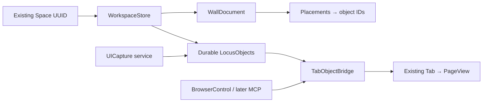

# Space → Wall: smallest safe architecture

Status: architectural baseline. The first slice is now implemented; see
[WALL_MVP.md](WALL_MVP.md) for scope, differences and validation.
Native capture objects and owned PNG assets are implemented; see
[UI_CAPTURE.md](UI_CAPTURE.md) for its data contract, coverage and validation.
Explicit Space object search is also implemented in the existing address field;
see [OBJECT_SEARCH.md](OBJECT_SEARCH.md).
Durable tab bindings are implemented; see [TAB_OBJECT_BINDING.md](TAB_OBJECT_BINDING.md).
Undo-close bindings, explicit reference updates and capture lineage are
implemented; see [PAGE_REFERENCE_LIFECYCLE.md](PAGE_REFERENCE_LIFECYCLE.md).
Visual inspiration, semantic relationships, resizing, viewport persistence and
saved AI evidence are implemented; see [INSPIRATION_GRAPH.md](INSPIRATION_GRAPH.md).
Native web-link drops reuse the inspiration payload and existing atomic writer;
see [WALL_LINK_DROPS.md](WALL_LINK_DROPS.md).
Contextual creation, card menus, searchable connections and viewport fitting
reuse the same records and writer; see [WALL_CONTEXT_MENUS.md](WALL_CONTEXT_MENUS.md).
Remaining work and release boundaries are tracked in [DEVELOPMENT_ROADMAP.md](DEVELOPMENT_ROADMAP.md).
Source baseline: `cddb9cdd19e64321c95d5e733217799908ad3b52`.

## Decision

Add a **Space-keyed document sidecar** and a **native Wall tab**.
Use `Space.id` as the workspace identity without altering Space's schema or
WebKit data-store selection. Keep Browser/Tab as the native browser runtime.
Objects are durable records; Wall nodes are placements of those records;
live browser views are runtime bindings. This provides a common object
abstraction without rewriting tabs into a generic document engine.



The first implementation should support only web-page references and notes,
plus placement/move/edit/open/delete. Other object kinds are schema direction,
not requirements to ship every node renderer or integrate an agent scheduler.
No AI download, network enrichment or extra WebKit process is needed for Wall.

## Ownership and identity

- Space definitions remain global across windows; tab rows remain per window.
  WorkspaceStore is shared per Space across windows in this app process.
  Each window keeps its own native Wall tab and selection, with validated
  viewport preferences saved per window UUID and Space UUID.
- `Tab.id` remains a runtime UUID. A new `LocusObject.id` is durable. Do not use
  URL, session index or pin letter as object identity: duplicate URLs, redirects,
  reorder and restoration break those assumptions.
- A page object represents a deliberately saved page reference. Adding the
  current tab to Wall creates/reuses its bound page object. Initial reopening
  can use its URL; a later optional Session.Entry.objectID restores the binding.
- Opening an object resolves a live bound Tab in the intended window/Space;
  otherwise use existing Browser adoption/navigation with that Space's store.
  Switching windows or Spaces is an explicit object action, not a side effect
  of looking at a thumbnail. Resolve stored IDs, not global `Spaces.current`.
- One object may have multiple placements; removing a placement does not delete
  the object. Closing a tab preserves the object. Deleting an object removes
  its placements and relationships under one workspace mutation; it does not
  silently close a page. A moved tab does not silently move a workspace record.
- A capture is an immutable, timestamped observation linked to its source page;
  the page reference changes title/URL only through an explicit update action.
  Recapture starts a new selection and creates a new capture with a `derivedFrom`
  relationship.
- MVP objects belong to exactly one Space. Cross-Space transfer is a later
  explicit copy/import, with assets copied and links reconciled. No global
  object graph or guessed cross-Space history is required initially.

## Proposed persisted shape

Illustrative schema, not Swift implementation:

```text
WorkspaceSnapshot
  schemaVersion: Int
  spaceID: UUID
  revision: Int
  objects: [LocusObject]
  wall: WallDocument

LocusObject
  id: UUID
  type: String                  // page, note, uiCapture, file, task, ...
  payloadVersion: Int
  title: String
  createdAt / updatedAt: Date
  source: Source?               // URL/file bookmark + provenance, no secrets
  metadata: bounded JSON values
  content: typed payload or asset references
  relationships: [{kind: String, targetID: UUID}]
  capabilities: [String]        // declared action names, never permission grants

WallDocument
  id: UUID
  placements: [{id, objectID, x, y, width, height, z}]
  edges: [{id, fromPlacementID, toPlacementID, relationKind?, label?}]
```

Use a type-discriminated Codable payload for supported types, with an opaque
JSON fallback for unknown types. Preserve unknown fields/types on round trip;
an unknown object renders as a read-only placeholder. Metadata is not an
unbounded substitute for typed content. Validate UUID uniqueness, finite
coordinates, size limits and relationship targets before writing. Unsupported
future document versions are read-only, not decoded into an empty workspace.

Suggested payloads:

| Type | Payload / relationship |
|---|---|
| page | URL and saved title; optional tab binding handled outside serialized content |
| note | Plain text initially; format/version explicit |
| tabGroup | Existing TabGroup ID plus member object IDs; group owns browser grouping, object projects it |
| file / PDF | Security-scoped bookmark for external file, or owned imported asset; never only an absolute path |
| repository | Repository URL and optional pinned revision; enrichment only on request |
| uiCapture / domElement / uiReference | Capture manifest, DOM locator, styles, geometry and asset IDs |
| screenshot / designTokens | Image asset or typed token entries with source provenance |
| aiOutput | Text, provider/model, captured source IDs, timestamp; saved only by user action |
| task / agent | Durable description/state and runtime handle references; no serialized processes or permission tokens |

Spatial position lives on placement, not the object envelope: this expresses
optional placement and allows several views of the same object without
conflicting positions. Relationships link semantic object identities; Wall
edges link presentations and can optionally represent a semantic relationship.

Capabilities such as `open`, `edit`, `recapture`, `revealFile` and `runTask` are
resolved by ObjectActions against supported payloads, live state and authority.
Persisted capabilities or captured page text cannot authorize browser actions.

## Storage and migration

1. Use `Store.file("workspaces/<spaceUUID>/workspace.json")` for one versioned
   snapshot containing objects and placements. Reuse Store's test-world root.
   A single file prevents partial object/placement commits in the first slice.
2. Keep assets in `workspaces/<spaceUUID>/assets/<assetUUID>.<extension>` with
   MIME, byte count and digest in a manifest. Stage assets first, then atomically
   publish a snapshot; interrupted captures may leave orphans, never missing
   committed assets. The implemented rolling previous revision also retains its
   referenced previews. Reconcile only understood snapshots after successful
   commits/reopen; damaged archives preserve assets for manual repair. See
   [STORAGE_RECOVERY.md](STORAGE_RECOVERY.md) for quotas, checksums and recovery.
3. Serialize mutations through one WorkspaceStore per Space. Reuse Disk's
   ordering pattern but add explicit write/error results for this store: Disk
   currently swallows write failures. Dirty state must remain dirty on failure.
   Publish revision changes to observing windows; they must not independently
   overwrite stale snapshots. Multi-process concurrent editing is out of MVP.
4. Missing sidecar means an empty Wall. Corrupt data is quarantined while the
   workspace remains unavailable for overwrite; the browser session still
   restores. A future schema is preserved read-only. A migration backs up the
   original, validates, then commits. Do not copy the session fallback behavior
   blindly into object storage, where it could lose unsupported objects.
5. Space deletion must stop/reject pending mutations, detach observers, and
   remove its workspace/owned assets under existing delete semantics. Prevent
   queued writes from recreating deleted folders. Shared-cookie stores remain
   governed by the existing `sharesSignIns` guard. External files are untouched.
6. Browser quit flushes pending workspace state in the same lifecycle as
   session/Windows writes. Session freshness toggles must not erase Wall data.
7. No bulk rewrite of sessions. Later add optional, lenient `objectID` decoding
   and encoding to Session.Entry, Browser.session and restoreRow. Existing
   entries need IDs only when explicitly materialized as objects. Older Search
   builds skip the field; they may remove it when saving, so URL reopen remains
   a fallback. Pin object binding uses durable pinID and per-window live tabs,
   not a single global Tab pointer. Never replace split index restoration.

Private tabs must not produce durable objects/captures by default. If temporary
private capture is later supported it stays in memory with private-tab lifetime,
without cloud AI, automatic assets or session IDs. Bench-created tabs also do
not become persistent objects automatically; exporting a result is explicit.
Capture and provenance must exclude held OAuth callback addresses and secrets.

## Native Wall presentation

The initial overlay has been replaced by a native kind in the existing tab row,
with one Wall per window/Space. The button beside Bookmarks opens/selects it;
Command-W closes it. Switching pages leaves it open. Native content occupies
ContentView's page stage only while selected, and never builds a WKWebView.
Existing Tab instances continue owning their web views and document state.

See [WALL_TABS.md](WALL_TABS.md) for the session marker, source-page actions,
privacy guards and current native tab capabilities. Objects and owned images
remain Space sidecars, independently of the tab lifetime. Canvas pan/zoom uses
Palette/Metrics/Motion; SpaceSwipe continues to own only tab chrome.

## Native UI Capture contract (next slice)

Integrate a service with existing `Tab.built` and isolated `Web.world` script
execution. Reuse picker/lifecycle patterns from Curtain/VeilRelay, not their
hide-element payload. No extension install or permanent injected sidebar.
Install picker only while invoked; remove handlers/styles/listeners on cancel,
commit, navigation, sleep, tab close and window/Space changes. If a handler is
registered in Tab.build, pair its name in Web.release and account for opener
configurations so duplicate registration never crashes.

Capture request pins window, Space, tab runtime ID, committed URL and a
navigation generation. Extract and snapshot asynchronously on the main actor;
verify generation/selection again before committing. Cancel stale results.
Bound DOM size/depth, assets and capture duration; perform heavy encoding off
the UI thread. A single timestamp does not promise atomic page/script pixels:
record extraction and snapshot timing separately.

| Evidence | Proposed extraction / limit |
|---|---|
| DOM | Selected subtree and locator including frame/shadow path; omit form values, hidden credentials and held sign-in callbacks. Open shadow roots where accessible; closed roots explicitly unavailable. |
| CSS | Bounded computed property map, discovered custom properties, ::before/::after style/content when exposed. Cross-origin stylesheets may block enumeration: preserve computed results and coverage status. |
| Geometry | Bounding rect, scroll offsets, viewport, pageZoom, devicePixelRatio, relevant transforms and clipping. Store coordinate space; map CSS pixels to native snapshot points. |
| Screenshot | WKSnapshotConfiguration crop on the existing rendered PageView; clamp bounds and record scale. State if only visible crop was captured or the element moved. |
| Fonts | Computed family/weight/size/line height and accessible FontFace metadata; identify fallback uncertainty. Font binaries are separate assets only when obtainable. |
| Images/SVG/assets | currentSrc/background URLs, accessible inline SVG, asset MIME/hash and fetch status. Cross-origin/resource restrictions are explicit; never substitute credential-bearing page requests into generic downloads. |
| Interaction/motion | Link target, roles, enabled state, transition/animation declarations and exposed Web Animations timing. Event listeners/closed component state cannot be completely inferred; do not trigger actions to observe them. |
| Accessibility | DOM role/ARIA, labels, alt, state and inferred accessible name with method/version. Do not label this a complete native AX tree unless verified through a separate native extraction. |

Each field reports `captured`, `unavailable`, `truncated` or `failed` and a reason.
Same-origin nested frames can be handled deliberately later; cross-origin frames
require separate supported frame extraction or remain partial. Page content is
untrusted data. Structured captures become objects with snapshot assets and
`capturedFrom` links; dropping onto Wall creates a placement, not a second copy.
Actual UI Sniper code reuse requires its source and license; neither is in the
fork as inspected. This contract does not claim full browser/CDP parity.

## Later command and agent evolution

Extend the existing field with typed intents incrementally: first Open Wall and
Capture UI; then object search and explicit AI/task actions. URL navigation and
current search behavior retain priority unless the user chooses an action.
Suggestions must carry real typed targets rather than adding more dummy URLs.
An AI answer is content; an agent operation is a separately authorized action.

Extract only shared operations needed by new automation verbs into BrowserControl.
Bench remains a compatibility front end, with its existing checks retained.
Add explicit Space/window/object targets, cancellation, typed errors and job IDs
for slow capture. MCP translates requests into that same layer. Keep transport
consent, private exclusion and ownership checks; never let object capabilities,
DOM instructions or an AI output grant access. A durable task runtime with
scheduling, agent lifecycle and scoped grants is a later design, not part of
Space → Wall MVP.

## Implementation sequence and acceptance gates

1. Review this decision and repository map. No runtime work in this audit.
2. Add schema/store/WallDocument with fixture-based compatibility tests. Test
   old/missing/corrupt/future data, write failure, rapid mutations, deleted Space
   writes and multiple windows editing one workspace.
3. Add invoked Wall with page references/notes and cached thumbnails. Verify
   pan/zoom, focus return, Spaces off/on, empty Spaces, split pages, floating
   pages and fullscreen. Demonstrate no additional WKWebViews on opening Wall.
4. Add tab/object restoration binding only if durable live reattachment is
   needed. Test duplicate URLs, navigation, closing/reopening, pin synchronization,
   Space moves, oldest-window promotion and old sessions/split indices.
5. Add native capture after bounded schema/lifecycle tests: navigation races,
   scale/crop, open shadow roots, iframe restrictions, pseudo-elements,
   unavailable assets, private tabs and handler teardown.
6. Add explicit commands/AI save, then BrowserControl/MCP as independent slices.

Before browser changes, establish an isolated baseline using the repository's
Swift tests and relevant Bench UI regressions (fresh window, split view, close
panel, tab switcher, pins). Existing test tools include named SEARCH_PROBE worlds;
use these and never wipe the user's installed browser. Measure cold restore,
tab switch and Wall opening; require no extra page construction from thumbnails
and no change to tab state after repeated Wall opens/closes.

The initial documentation pass did not build, launch or run those tests: no runtime
code changed. Product rename, Space-local history and UI Sniper integration
remain separately staged work, not completed features.
